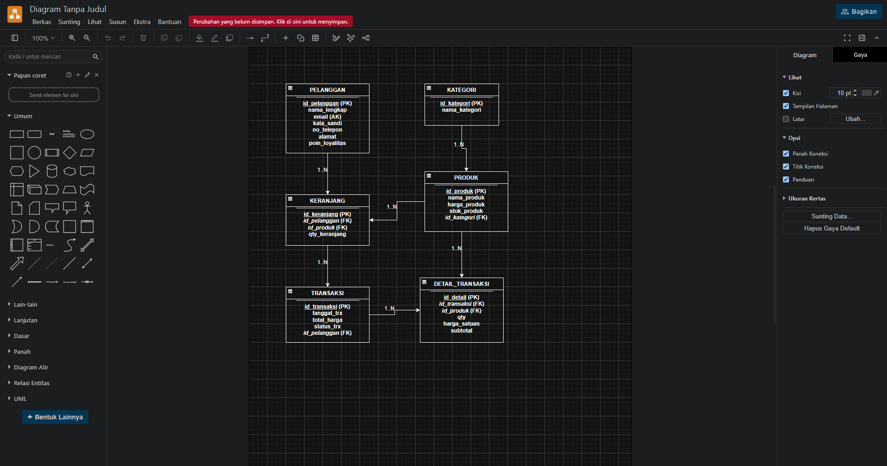
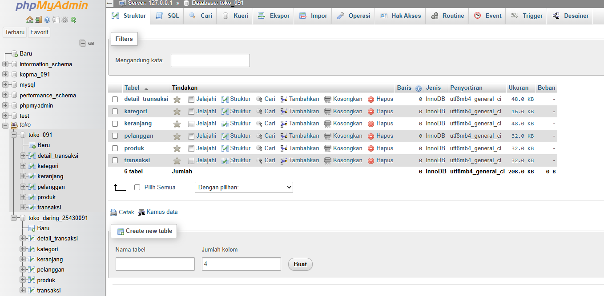
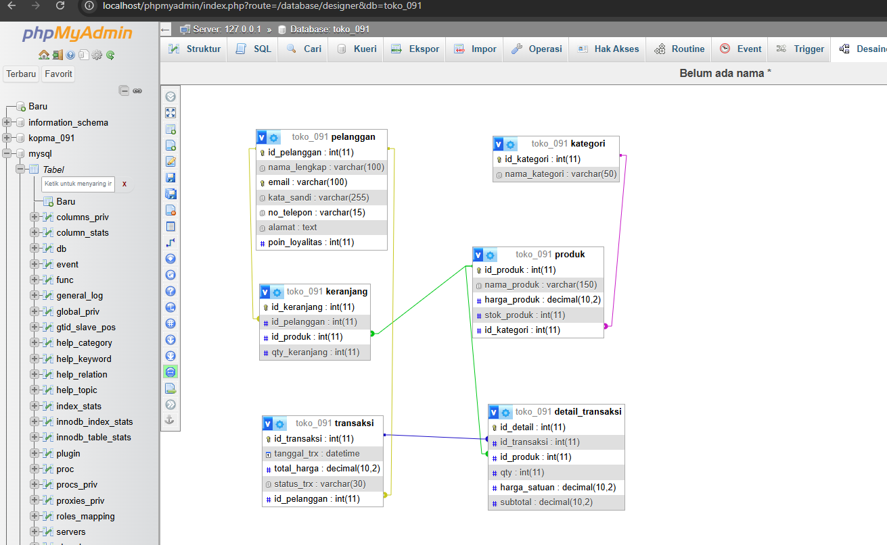
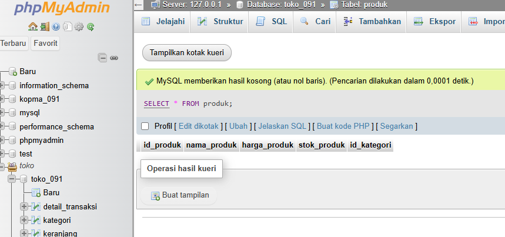

# Laporan Praktikum Basis Data - Pertemuan 03
**Nama:** Zidan Fidha B   **NPM:** 25430091   **Kelas:** D   **Tanggal:** 14 Oktober 2026   **Dosen Pengampu:** Dedi Irawan, S.Kom., M.T.I.

## 1. Tujuan Praktikum
* Memahami konsep perancangan pemodelan basis data konseptual dan logikal menggunakan *Entity-Relationship Diagram* (ERD).
* Mampu merancang entitas, atribut, kunci utama (*Primary Key*), kunci tamu (*Foreign Key*), serta kardinalitas relasi antar entitas untuk sistem Toko Daring.
* Mampu mentransformasikan model ERD konseptual ke dalam implementasi tabel fisik basis data relasional di *phpMyAdmin* (MySQL/MariaDB).

## 2. Ringkasan Dasar Teori
Perancangan basis data merupakan tahapan krusial dalam membangun sistem informasi yang andal. *Entity-Relationship Diagram* (ERD) digunakan untuk memvisualisasikan struktur data dan hubungan antar entitas secara konseptual. Dalam sistem basis data relasional, hubungan antar entitas diklasifikasikan ke dalam kardinalitas seperti *One-to-Many* ($1:N$) dan *Many-to-Many* ($M:N$) yang kemudian dinormalisasi atau dipecah menggunakan entitas asosiatif guna menghindari redundansi data serta menjaga integritas referensial melalui batasan *Foreign Key*.

## 3. Hasil Langkah Percobaan
* **Berkas Sumber ERD:** `p03_erd_25430091.drawio`
* **Berkas Gambar ERD:** `p03_erd_25430091.png`
**1. Tangkapan Layar Desain ERD (Draw.io):**

**2. Tangkapan Layar Struktur Tabel (phpMyAdmin):**

**3. Tangkapan Layar Desainer Relasi (phpMyAdmin):**

**4. Tangkapan Layar Pengujian Kueri Data (phpMyAdmin):**

## 4. Jawaban Titik Analisis
* **Analisis Struktur Entitas:** Sistem Toko Daring terdiri dari 6 entitas utama (`Pelanggan`, `Kategori`, `Produk`, `Keranjang`, `Transaksi`, dan `Detail_Transaksi`) yang saling terhubung untuk mengakomodasi alur jual beli online
* **Analisis Entitas Asosiatif (`Detail_Transaksi`):** Berfungsi untuk memecah relasi *Many-to-Many* antara `Transaksi` dan `Produk` dengan menyertakan atribut khusus seperti `qty`, `harga_satuan`, dan `subtotal` guna memastikan pencatatan riwayat transaksi akurat terhadap perubahan harga di masa depan

### Tabel Relasi, Kardinalitas, dan Aturan Bisnis (AB)

| Entitas 1 | Kardinalitas | Entitas 2 | Aturan Bisnis (Kode AB) Terkait | Alasan Kardinalitas Utama |
| :--- | :---: | :--- | :--- | :--- |
| **Pelanggan** | $1 : N$ | **Keranjang** | **AB-01, AB-03:** Pelanggan dapat memasukkan beberapa item barang ke keranjang. | Satu pelanggan dapat menyimpan banyak produk di dalam keranjang belanjanya. |
| **Produk** | $1 : N$ | **Keranjang** | **AB-03:** Suatu produk dapat berada di dalam banyak keranjang pelanggan. | Satu produk yang sama dapat dimasukkan ke keranjang oleh banyak pelanggan berbeda. |
| **Pelanggan** | $1 : N$ | **Transaksi** | **AB-01, AB-04, AB-06:** Pelanggan dapat membuat satu atau banyak pesanan. | Seorang pelanggan dapat melakukan transaksi pembelian berkali-kali seiring waktu. |
| **Kategori** | $1 : N$ | **Produk** | **AB-07:** Satu kategori menampung banyak produk, setiap produk memiliki satu kategori. | Pengelompokan produk dikelola agar satu jenis kategori memiliki banyak daftar barang. |
| **Transaksi** | $1 : N$ | **Detail_Transaksi** | **AB-02, AB-06:** Satu transaksi terdiri dari satu atau lebih rincian barang. | Memecah relasi *many-to-many* antara Transaksi dan Produk agar pencatatan barang akurat. |
| **Produk** | $1 : N$ | **Detail_Transaksi** | **AB-02, AB-03, AB-07:** Satu produk dapat dicatat dalam banyak rincian transaksi. | Suatu produk dapat dibeli kembali dalam berbagai transaksi berbeda oleh pelanggan. |

## 5. Hasil Latihan dan Modifikasi
Pemetaan kebutuhan informasi ke dalam jalur ERD:

| Kebutuhan Informasi (KI) | Jalur Penelusuran ERD | Penjelasan Kebutuhan Data |
| :--- | :--- | :--- |
| **KI-01:** Laporan Penjualan Bulanan | `Transaksi` | Mengagregasi `total_harga` dan menghitung jumlah transaksi berdasarkan `tanggal_trx`. |
| **KI-02:** Laporan Stok Menipis | `Produk` | Memfilter baris data pada tabel `Produk` yang memiliki nilai `stok_produk < 5`. |
| **KI-03:** Riwayat Belanja Pelanggan | `Pelanggan` $\rightarrow$ `Transaksi` $\rightarrow$ `Detail_Transaksi` $\rightarrow$ `Produk` | Menghubungkan profil `Pelanggan` ke `Transaksi`, lalu mengambil rincian barang di `Detail_Transaksi`. |
| **KI-04:** Laporan Poin Loyalitas | `Pelanggan` $\rightarrow$ `Transaksi` | Membaca saldo `poin_loyalitas` pada entitas `Pelanggan` serta melacak riwayat transaksinya. |
| **KI-05:** Laporan Produk Terlaris | `Produk` $\rightarrow$ `Detail_Transaksi` $\rightarrow$ `Transaksi` | Menjumlahkan total `qty` pada `Detail_Transaksi` untuk setiap `id_produk` dalam periode waktu tertentu. |

## 6. Tugas Mandiri: Milestone Proyek 03
Penyelesaian Milestone 3 meliputi perancangan desain ERD sistem "Toko Daring", penentuan aturan bisnis (*Business Rules*), pembuatan skrip basis data relasional di phpMyAdmin, serta penyusunan laporan komprehensif

## 7. Pembahasan dan Kendala
* **Pembahasan:** Seluruh relasi kardinalitas (seperti hubungan *1-to-N* antara Kategori ke Produk, Pelanggan ke Transaksi, dan Transaksi ke Detail_Transaksi) telah dirancang sesuai aturan bisnis. Pemisahan tabel `Keranjang` dengan `Transaksi` juga berhasil diimplementasikan agar stok produk tidak terkunci saat pengguna masih meninjau keranjang belanja.
* **Kendala:** Tidak ada kendala berarti selama proses perancangan diagram di Draw.io maupun pembuatan basis data di phpMyAdmin

## 8. Kesimpulan
Perancangan ERD konseptual dan implementasi fisik basis data untuk proyek Toko Daring telah diselesaikan dengan sukses. Seluruh entitas, atribut, batasan relasi, serta kebutuhan informasi laporan telah terintegrasi secara optimal ke dalam struktur basis data relasional

## 9. Pernyataan Penggunaan AI
Saya menyatakan bahwa saya menggunakan alat bantu AI sebagai panduan referensi dan penyusunan struktur teks laporan praktikum ini, di mana seluruh pemahaman konsep, perancangan ERD, dan kode basis data diverifikasi dan disesuaikan secara mandiri.

## 10. Bukti Git
* **Tautan Repositori:** (https://github.com/zidan0316/basisdata-25430091)
* **Hash Commit:** `a976d16  (feat: complete milestone 3 ERD and database schema)`

## Checklist
* [x] `p03_erd_25430091.drawio` dan `p03_erd_25430091.png` tersedia
* [x] Tangkapan layar ERD di Draw.io dengan kardinalitas terbaca
* [x] Pemetaan entitas ke PB/KI dari Pertemuan 2 & alasan kardinalitas relasi utama