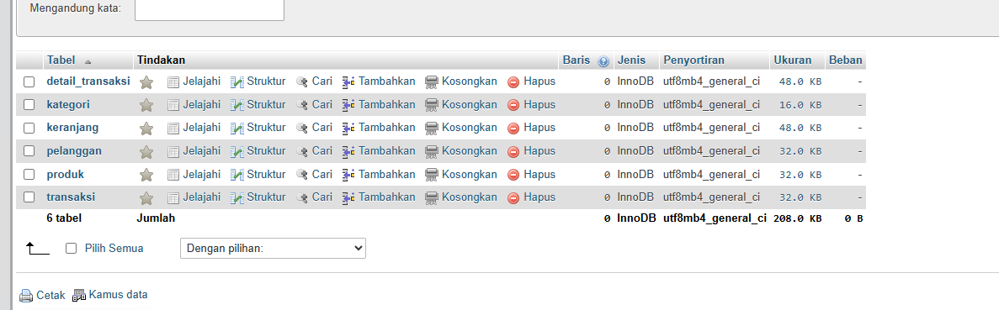
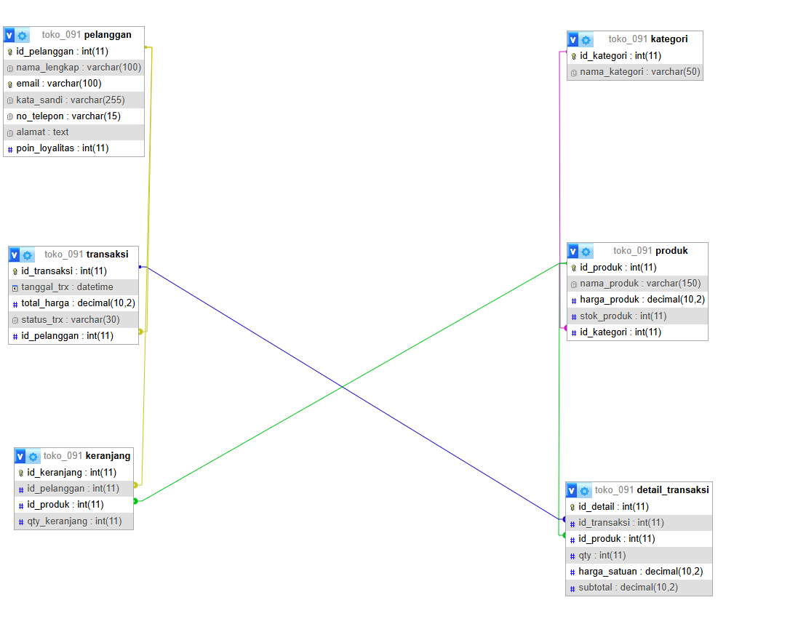
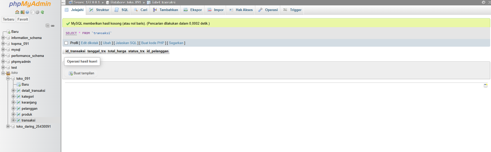
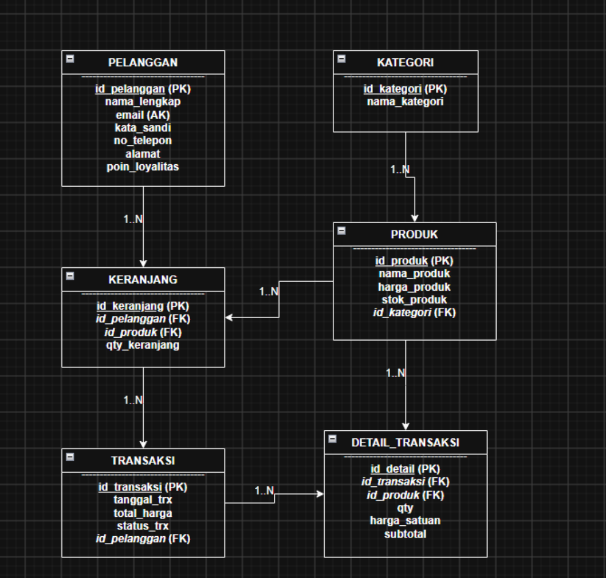

# Laporan Praktikum Basis Data - Pertemuan 04
**Nama:** Zidan Fidha B &nbsp;&nbsp;&nbsp;&nbsp; **NIM:** 25430091 &nbsp;&nbsp;&nbsp;&nbsp; **Kelas:** D &nbsp;&nbsp;&nbsp;&nbsp; **Tanggal:** 20 Oktober 2026

---

## 1. Tujuan Praktikum
1. Memahami konsep ketergantungan fungsional (*functional dependency*) dan penentuan kunci penentu (*determinant*).
2. Memahami dan menerapkan tahapan normalisasi basis data mulai dari UNF, 1NF, 2NF, 3NF, hingga evaluasi BCNF.
3. Mampu mengidentifikasi serta mengatasi berbagai anomali basis data (anomali sisip, ubah, dan hapus).
4. Mampu mengambil keputusan yang tepat terkait penyimpanan nilai turunan (*derived attribute*).
5. Menerapkan hasil analisis normalisasi pada pengembangan skema proyek basis data **Toko Daring**.

---

## 2. Ringkasan Dasar Teori
Normalisasi adalah proses organisasional dalam perancangan basis data untuk mengelompokkan atribut-atribut menjadi entitas yang stabil dan meminimalkan redundansi data.

1. **Unnormalized Form (UNF):** Bentuk data mentah sebagaimana diterima dari dokumen sumber (seperti faktur/struk) yang masih mengandung pengulangan grup data (*repeating groups*).
2. **First Normal Form (1NF):** Memastikan setiap sel data bersifat bernilai tunggal (*atomic value*) dan tidak ada kolom yang berulang.
3. **Second Normal Form (2NF):** Memenuhi 1NF dan tidak memiliki ketergantungan parsial (*partial dependency*), di mana semua atribut non-kunci bergantung penuh pada seluruh komponen *Primary Key*.
4. **Third Normal Form (3NF):** Memenuhi 2NF dan tidak memiliki ketergantungan transitif (*transitive dependency*), yaitu atribut non-kunci tidak boleh bergantung pada atribut non-kunci lainnya.
5. **Boyce-Codd Normal Form (BCNF):** Bentuk normalisasi yang lebih ketat dari 3NF, di mana untuk setiap ketergantungan fungsional $X \rightarrow Y$, $X$ harus merupakan *Candidate Key*.

---

## 3. Hasil Langkah Percobaan
Berikut adalah bukti penyiapan struktur database dan relasi hasil normalisasi yang dijalankan pada server lokal phpMyAdmin:

### a. Struktur Tabel Database (`toko_daring_25430091`)
  
*Keterangan: Tampilan daftar seluruh tabel yang telah terbentuk setelah memisahkan entitas berdasarkan aturan normalisasi 3NF.*

### b. Tampilan Relasi Antar Tabel (Designer)
  
*Keterangan: Tampilan relasi Foreign Key antar tabel pelanggan, kategori, produk, transaksi, dan detail_transaksi.*

### c. Pengujian dan Tampilan Data
  
*Keterangan: Sampel isi data transaksi dan detail transaksi yang menunjukkan tidak adanya duplikasi data anggota/pelanggan.*

---

## 4. Jawaban Titik Analisis
1. **Mengapa ketergantungan transitif perlu dihilangkan pada 3NF?**  
   *Jawaban:* Ketergantungan transitif menyebabkan redundansi data dan memicu terjadinya anomali saat pembaruan (*update anomaly*). Jika nilai atribut non-kunci berubah, kita harus memperbaruinya di banyak baris. Jika ada satu baris yang terlewat, data menjadi tidak konsisten.

2. **Kapan nilai turunan (*derived attribute*) diperbolehkan untuk disimpan di basis data?**  
   *Jawaban:* Nilai turunan (seperti `subtotal` atau `total_harga`) diperbolehkan disimpan untuk efisiensi dan optimasi kinerja kueri (*query performance*), terutama pada sistem OLTP dengan volume transaksi tinggi, sehingga sistem tidak perlu melakukan kalkulasi ulang secara terus-menerus.

---

## 5. Hasil Latihan dan Modifikasi

### Soal 1: Normalisasi Nomor Telepon Pemasok (Multivalued Attribute)
* **Kondisi:** Satu pemasok dapat memiliki lebih dari satu nomor telepon (*multivalued attribute*).
* **Hasil Normalisasi (1NF):** Memisahkan atribut nomor telepon ke dalam relasi/tabel terpisah:
  * `pemasok` (**id_pemasok** [PK], nama_pemasok, alamat_pemasok)
  * `telepon_pemasok` (**id_telepon** [PK], *id_pemasok* [FK], no_telepon)

### Soal 2: Anomali Ubah jika `nama_anggota` Disimpan di Tabel Penjualan
* **Contoh Melanggar 3NF:** Tabel `penjualan` (**id_penjualan**, tanggal, id_anggota, nama_anggota, total). Kolom `nama_anggota` bergantung secara transitif pada `id_anggota`.
* **Kueri Ubah (Menimbulkan Anomali Ubah):**
  ```sql
  UPDATE penjualan 
  SET nama_anggota = 'Budi Santoso' 
  WHERE id_anggota = 'A001';
  ```
* **Penjelasan Anomali:** Jika anggota `A001` melakukan 10 kali transaksi, namanya tercatat berulang 10 kali. Apabila kueri di atas gagal memperbarui seluruh baris secara konsisten, maka nama anggota pada transaksi lama dan baru akan berbeda.

---

## 6. Tugas Mandiri: Milestone Proyek 4

### a. Titik Awal UNF (Unnormalized Form)
Dokumen mentah struk pesanan Toko Daring:
`UNF = {id_transaksi, tanggal_trx, id_pelanggan, nama_pelanggan, email_pelanggan, no_telepon_pelanggan, alamat_pelanggan, id_produk, nama_produk, harga_produk, qty, subtotal, total_harga, status_trx}`

### b. Dependensi Fungsional
1. `id_pelanggan` $\rightarrow$ `nama_pelanggan, email_pelanggan, no_telepon_pelanggan, alamat_pelanggan`
2. `id_produk` $\rightarrow$ `nama_produk, harga_produk`
3. `id_transaksi` $\rightarrow$ `tanggal_trx, total_harga, status_trx, id_pelanggan`
4. `(id_transaksi, id_produk)` $\rightarrow$ `qty, subtotal`

### c. Tahapan Normalisasi (1NF, 2NF, 3NF, BCNF)
* **1NF:** Memastikan seluruh sel bersifat atomik dan memisahkan grup barang belanjaan yang berulang.
* **2NF:** Menghilangkan ketergantungan parsial dengan membentuk tabel terpisah: `pelanggan`, `produk`, dan `transaksi`.
* **3NF:** Menghilangkan ketergantungan transitif dengan membentuk tabel `detail_transaksi` untuk menyimpan atribut transaksi item (`qty`, `harga_satuan`, `subtotal`).
* **Pemeriksaan BCNF:** Setiap penentu (*determinant*) pada seluruh relasi yang terbentuk merupakan kunci utama (*Primary Key*), sehingga skema memenuhi BCNF.

### d. Keputusan Penyimpanan Nilai Turunan
* **Keputusan:** Atribut `subtotal` dan `total_harga` **tetap disimpan**.
* **Alasan:** Mempercepat waktu pemrosesan kueri laporan penjualan tanpa melakukan *join* dan penjumlahan matematis berulang pada data transaksi dalam jumlah besar.

### e. Pembaruan Diagram ERD
  
*Keterangan: Diagram ERD Toko Daring yang telah dinormalisasi hingga 3NF/BCNF.*

---

## 7. Pembahasan dan Kendala
* **Pembahasan:** Proses normalisasi berhasil memecah tabel raksasa mentah (UNF) menjadi 5 tabel yang saling terhubung secara konsisten, yaitu `pelanggan`, `kategori`, `produk`, `transaksi`, dan `detail_transaksi`.
* **Kendala:** Sempat timbul keraguan terkait penyimpanan atribut `subtotal` dan `total_harga`, namun akhirnya diputuskan untuk disimpan demi efisiensi performa pencarian dan laporan.

---

## 8. Kesimpulan
1. Penerapan normalisasi hingga bentuk 3NF/BCNF berhasil menghilangkan pengulangan data (*redundansi*) dan mencegah terjadinya anomali data (sisip, ubah, dan hapus) pada database Toko Daring.
2. Penyimpanan nilai turunan seperti `total_harga` dan `subtotal` diperbolehkan dengan pertimbangan optimasi performa *querying* laporan.

---

## 9. Pernyataan Penggunaan AI
Dalam pengerjaan praktikum ini, AI (Gemini) digunakan sebagai asisten diskusi untuk memahami konsep dasar ketergantungan fungsional, memvalidasi tahapan bentuk normal 1NF-3NF, serta menyusun skrip kueri SQL dan dokumentasi laporan.

---

## 10. Bukti Git
* **Tautan Repositori:** [https://github.com/zidan0316/BasisData_25430091](https://github.com/zidan0316/BasisData_25430091)
* **Hash Commit:** `ebb7c43`

---

## Checklist
- [x] Mengisi identitas mahasiswa dengan lengkap.
- [x] Menuliskan tujuan praktikum dan ringkasan dasar teori secara jelas.
- [x] Menyertakan tangkapan layar hasil langkah percobaan beserta keterangannya.
- [x] Menjawab seluruh pertanyaan titik analisis.
- [x] Mengerjakan soal latihan dan modifikasi (Nomor 1 dan 2).
- [x] Menyelesaikan seluruh tahapan Tugas Mandiri Milestone Proyek 4 (UNF hingga BCNF & keputusan atribut turunan).
- [x] Memperbarui dan menyertakan diagram ERD terbaru.
- [x] Mengisi pembahasan, kendala, dan kesimpulan.
- [x] Menyertakan pernyataan penggunaan AI.
- [x] Mencantumkan tautan repositori GitHub dan Hash Commit yang valid.